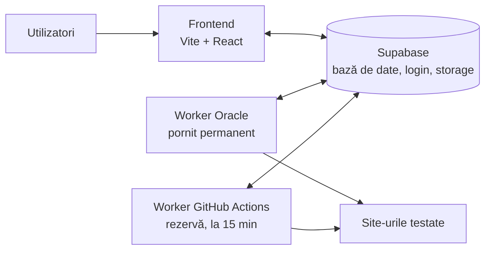

# FlowGuardian — ghid de operare

Tot ce trebuie ca să pornești, oprești, actualizezi și depanezi FlowGuardian.
**Fără chei în acest fișier** — repo-ul e public. Cheile stau doar în `.env` (local), GitHub Secrets, Supabase Vault și pe server.

---

## 1. Cum e construit



| Piesă | Unde rulează | Ce face |
|---|---|---|
| **Frontend** | local (`npm run dev:fe`), mai târziu Render/Vercel | Interfața. Vorbește doar cu Supabase. |
| **Supabase** | supabase.com | Baza de date, login, capturi de ecran, coada de joburi. |
| **Worker Oracle** | server Oracle, pornit permanent | Scanări, teste, AI, API Guardian. Preia joburile în ~2 s, 2 în paralel. |
| **Worker GitHub** | GitHub Actions, la 15 min | Rezervă: dacă serverul cade, tot se rulează testele programate. |

Joburile stau într-o coadă în Supabase; fiecare job e luat de **un singur** worker (fără dubluri), indiferent câți rulează.

---

## 2. Lucru local

```bash
cd ~/projects/FlowGuardian

npm run dev:fe        # doar interfața → joburile le face serverul Oracle (recomandat)
npm run dev           # interfața + worker local (când modifici codul worker-ului)
npm run dev:worker    # o singură rulare a worker-ului local
npm run install:all   # instalează dependențele (după clone)
```

Frontend: http://localhost:5173

Fișierul `.env` (în rădăcina proiectului, **nu intră în git**) are:
`SUPABASE_URL`, `SUPABASE_SERVICE_ROLE_KEY`, `WORKER_BUDGET_MS`, `GEMINI_API_KEY`, `GEMINI_MODEL`, `VITE_SUPABASE_URL`, `VITE_SUPABASE_ANON_KEY`.
Model: `.env.example`.

---

## 3. Serverul Oracle (worker permanent)

| | |
|---|---|
| Furnizor | Oracle Cloud Always Free, regiunea Frankfurt (`eu-frankfurt-1`), AD-2 |
| Instanță | `flowguardian-worker` — VM.Standard.A1.Flex, 1 OCPU ARM, 6 GB RAM |
| Sistem | Ubuntu 24.04 (aarch64) |
| IP public | `158.180.52.10` (Ephemeral — se poate schimba dacă recreezi instanța) |
| Utilizator SSH | `ubuntu` |
| Cheie SSH | `~/.ssh/oracle_fg` în WSL (originalul: `Downloads\ssh-key-2026-11-09.key`) |
| Cod | `/opt/flowguardian` (clonă din GitHub, branch `master`) |
| Chei | `/etc/flowguardian.env` (citibil doar de root și worker) |
| Serviciu | `flowguardian-worker` (systemd, pornește la boot, repornește la eroare) |
| Actualizare | `flowguardian-update.timer` — la 5 min verifică GitHub; dacă e cod nou, îl ia și repornește worker-ul |

### Conectare
```bash
ssh -i ~/.ssh/oracle_fg ubuntu@158.180.52.10
```

### Comenzi utile (pe server)
```bash
sudo systemctl status flowguardian-worker        # rulează?
sudo journalctl -u flowguardian-worker -f        # loguri live (Ctrl+C ca să ieși)
sudo journalctl -u flowguardian-worker --since "-1h"   # ultima oră
sudo systemctl restart flowguardian-worker       # repornire
sudo systemctl stop flowguardian-worker          # oprire (termină întâi joburile începute)
sudo systemctl start flowguardian-worker         # pornire
sudo /usr/local/bin/flowguardian-update          # actualizare imediată din GitHub
systemctl list-timers flowguardian-update.timer  # când e următoarea verificare
```

### Fără să intri pe server (din WSL)
```bash
ssh -i ~/.ssh/oracle_fg ubuntu@158.180.52.10 'sudo journalctl -u flowguardian-worker -f'
ssh -i ~/.ssh/oracle_fg ubuntu@158.180.52.10 'sudo systemctl restart flowguardian-worker'
```

### Setări worker (`/etc/flowguardian.env`)
| Variabilă | Valoare | Rol |
|---|---|---|
| `SUPABASE_URL` | URL-ul proiectului | |
| `SUPABASE_SERVICE_ROLE_KEY` | cheia secretă Supabase | |
| `GEMINI_API_KEY`, `GEMINI_MODEL` | cheia AI, `gemini-flash-lite-latest` | asistentul AI |
| `WORKER_MODE` | `daemon` | pornit permanent |
| `WORKER_SLOTS` | `2` | joburi în paralel (3 pe ≥4 procesoare) |

Editare: `sudo nano /etc/flowguardian.env` → apoi `sudo systemctl restart flowguardian-worker`.

### Reinstalare / server nou
Pe un Ubuntu nou (Oracle sau orice VPS):
```bash
curl -fsSL https://raw.githubusercontent.com/danut99/FlowGuardian/master/deploy/server-setup.sh | sudo bash
```
Cere cheile la final. **Introdu-le doar după ce apare întrebarea** (altfel se afișează în clar). Se poate rula din nou oricând; păstrează cheile existente.
Script: `deploy/server-setup.sh`.

### Oracle — de știut
- Serverul trebuie să aibă **IP public** (Networking → VNIC → IP administration → ⋯ → Edit → Ephemeral public IP).
- Nu e nevoie de porturi deschise: worker-ul doar face conexiuni spre exterior.
- Oracle poate recupera instanțele Always Free care stau aproape nefolosite ~7 zile; worker-ul rulând teste nu ar trebui să fie în situația asta.

---

## 4. GitHub (repo + rezervă)

Repo: https://github.com/danut99/FlowGuardian — branch `master`, **public** (minute Actions gratuite).

Workflow: `.github/workflows/run-tests.yml` („Run tests”)
- **La 15 min** (`Verificare programată`): programează testele, API Guardian, publicări, curățenie + joburile din coadă.
- **Manual**: Actions → Run tests → Run workflow (`interactive` = doar coada, `full` = tot).
- Rulările pornite din aplicație au nume ca `Analiză site · exemplu.ro`, `Teste (11) · exemplu.ro`.

**Secrets** (Settings → Secrets and variables → Actions):
`SUPABASE_URL`, `SUPABASE_SERVICE_ROLE_KEY`, `GEMINI_API_KEY`

GitHub oprește rularea programată după **60 de zile fără commit** — o repornești din tab-ul Actions.

---

## 5. Supabase

### Migrații
Fișierele din `backend/supabase/migrations/`, rulate **în ordine** în **Supabase → SQL Editor → New query → Run**.

| Migrație | Ce face |
|---|---|
| `0019_wake_worker.sql` | pornire imediată a worker-ului GitHub la acțiuni din aplicație |
| `0020_wake_on_manual_runs.sql` | același lucru pentru „Rulează”, analiză pagină, propuneri |
| `0021_parallel_workers.sql` | worker separat per acțiune + nume sugestive; max 5 la 3 min |
| `0022_enqueue_lock.sql` | testele programate nu se dublează când serverul și GitHub rulează simultan |

### Vault (Supabase → SQL Editor)
Folosit doar pentru pornirea imediată a worker-ului GitHub. **Cu serverul Oracle pornit, nu e nevoie de token.**

```sql
select name from vault.secrets;                                   -- ce există

-- pornire imediată pe GitHub ACTIVĂ (dacă serverul Oracle e oprit):
select vault.create_secret('github_pat_...', 'github_dispatch_token');
select vault.create_secret('danut99/FlowGuardian', 'github_repo');
select vault.create_secret('master', 'github_ref');

-- pornire imediată pe GitHub OPRITĂ (serverul Oracle face treaba):
delete from vault.secrets where name = 'github_dispatch_token';
```

Token GitHub: Settings → Developer settings → Fine-grained tokens → doar repo-ul **FlowGuardian**, permisiuni **Actions: Read and write** (+ Metadata: Read-only). Nimic altceva.

---

## 6. Schimbarea cheilor (dacă s-a scurs una)

**Cheia Supabase secretă** (`sb_secret_...`):
1. Supabase → Project Settings → API Keys → Secret keys → creează una nouă, **șterge-o pe cea veche**.
2. Pune-o în: `.env` local · GitHub Secrets `SUPABASE_SERVICE_ROLE_KEY` · server (`sudo nano /etc/flowguardian.env` + restart).

**Cheia Gemini**: aistudio.google.com → API keys → creează nouă / șterge veche → aceleași 3 locuri (`GEMINI_API_KEY`).

Copierea unei chei din `.env` local pe server, fără s-o afișezi:
```bash
grep -E '^GEMINI_(API_KEY|MODEL)=' .env | ssh -i ~/.ssh/oracle_fg ubuntu@158.180.52.10 \
  'sudo sh -c "sed -i \"/^GEMINI_/d\" /etc/flowguardian.env && cat >> /etc/flowguardian.env && systemctl restart flowguardian-worker"'
```
(Pentru Supabase: înlocuiește `GEMINI_(API_KEY|MODEL)` cu `SUPABASE_SERVICE_ROLE_KEY` și `^GEMINI_` cu `^SUPABASE_SERVICE_ROLE_KEY`.)

---

## 7. Depanare

| Simptom | Verifică |
|---|---|
| Butonul „Rulează…” stă mult | Serverul: `sudo systemctl status flowguardian-worker` + loguri. Dacă e oprit: `sudo systemctl start flowguardian-worker`. |
| Nimic nu se procesează | Coada în Supabase SQL: `select status, count(*) from runs where status in ('queued','running') group by 1;` |
| Rulări blocate în `running` (worker oprit brusc) | `update runs set status = 'queued', started_at = null where status = 'running' and started_at < now() - interval '30 minutes';` |
| Pornirea pe GitHub nu merge | `select created, status_code, left(content::text, 200) from net._http_response order by created desc limit 3;` → **204** ok · **403** token fără „Actions: Read and write” · **404** repo/branch greșit |
| Asistentul AI nu răspunde | `GEMINI_API_KEY` lipsește pe server, sau modelul e supraîncărcat (reîncearcă). |
| Nu te poți conecta prin SSH | IP schimbat (vezi Oracle → Instances → Details) sau instanța oprită (Start). |
| Serverul pare blocat | Oracle → Instances → flowguardian-worker → **Reboot**. Worker-ul pornește singur. |
